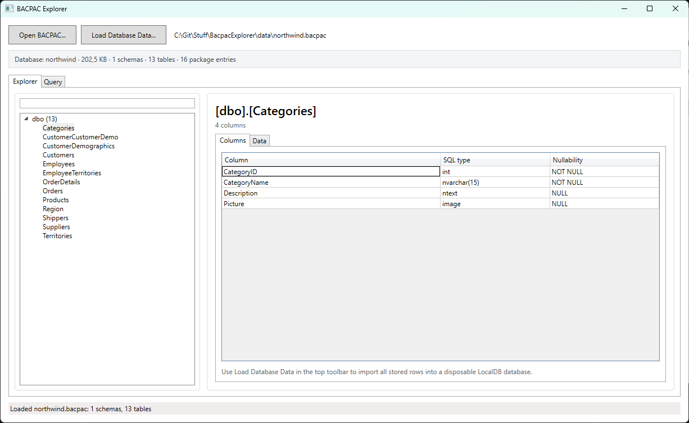
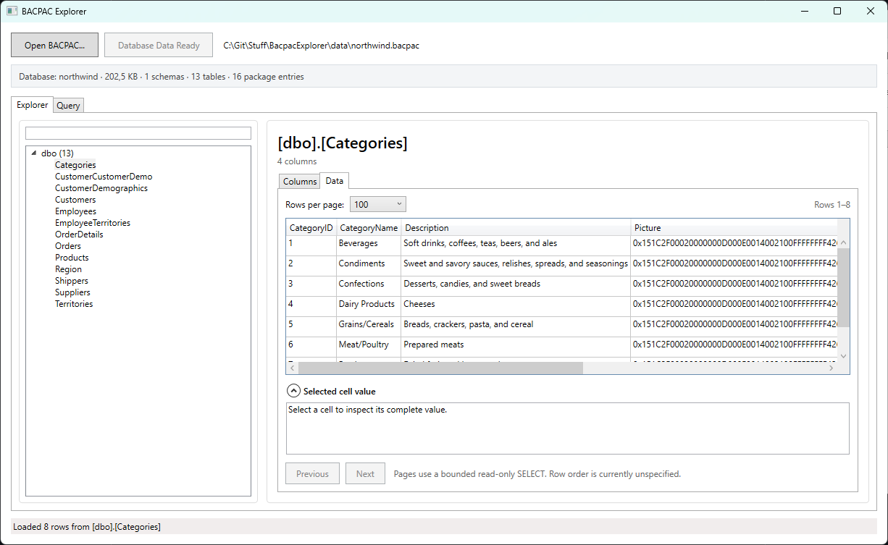
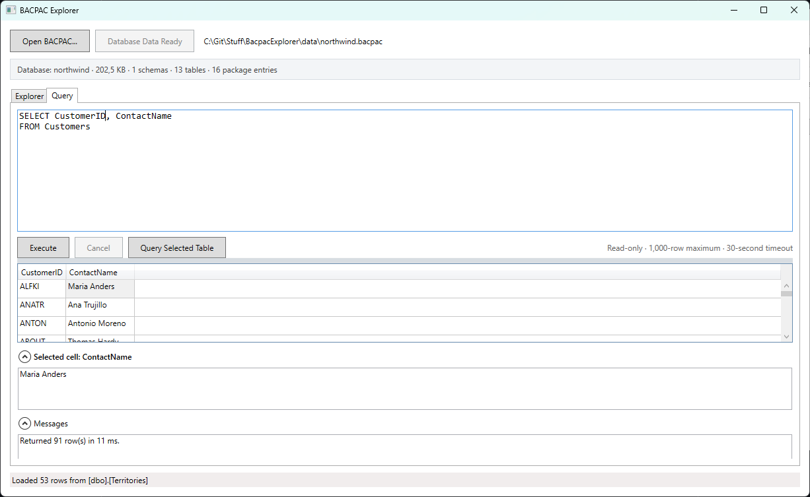

# BACPAC Explorer

BACPAC Explorer is a small Windows application for opening and inspecting SQL Server `.bacpac` files.

A BACPAC normally contains a database's structure and data. BACPAC Explorer lets you examine that content without manually restoring the database or installing SQL Server Management Studio.

## What can it do?

- Browse schemas, tables, columns, SQL data types, and nullable settings.
- Search the table list by schema, table, or column name.
- View stored rows in manageable pages.
- Inspect long or multiline cell values.
- Run read-only `SELECT` queries and view the results.
- Follow the Windows app theme, or choose Light or Dark from the sun/moon icon menu at the top right. Your choice is remembered between launches.

The original BACPAC file is never changed.

## Screenshots







## What do I need?

- 64-bit Windows.
- The [Microsoft .NET 10 Desktop Runtime for Windows x64](https://dotnet.microsoft.com/en-us/download/dotnet/10.0).
- [SQL Server Express LocalDB](https://learn.microsoft.com/en-us/sql/database-engine/configure-windows/sql-server-express-localdb) if you want to view rows or run queries.

LocalDB is the lightweight database component used by the application. You do not need a full SQL Server installation or SQL Server Management Studio. You can browse schemas and columns without LocalDB, but viewing data and querying require it.
If you have Visual Studio installed, you most likely already have the prerequisites installed as well.

## Getting started

1. Download `BacpacExplorer-win-x64.zip` from the [Releases page](https://github.com/frederiktoft/BacpacExplorer/releases).
2. Extract the ZIP to a folder.
3. Run `BacpacExplorer.exe`.
4. Select **Open BACPAC...** and choose your file.
5. Use the **Explorer** or **Query** tab.

If no packaged release is available yet, see **Building from source** below.

## Exploring a BACPAC

The **Explorer** tab shows the database structure.

1. Select a table to see its columns.
2. Use the search box to narrow down a large database.
3. Select **Load Database Data...** when you also want to inspect stored rows.
4. Open the table's **Data** tab and move between pages as needed.
5. Select a cell to view its complete value, including long or multiline text.

The first data load may take a while because the BACPAC is imported into a temporary LocalDB database. It is reused until you open another BACPAC or close the application.

## Running a query

Open the **Query** tab, enter a `SELECT` statement, and select **Execute**. You can also choose a table in Explorer and use **Query Selected Table** as a starting point.

Queries are deliberately restricted:

- Only one read-only `SELECT` query can run at a time.
- Results are limited to 1,000 rows.
- Queries time out after 30 seconds.
- Queries cannot modify the database.

## Temporary data and logs

Rows are imported into a temporary LocalDB database under your Windows user account. The application removes it when you open another BACPAC or exit normally. It also cleans up its own temporary databases left behind after a crash.

Diagnostic logs are written to a `Logs` folder beside the executable. If that folder is not writable, logs are stored in `%LOCALAPPDATA%\BacpacExplorer\Logs`. Query text, query results, connection strings, and complete BACPAC paths are not logged.

## Building from source

Developers need the .NET 10 SDK:

```powershell
dotnet build
dotnet test
dotnet run --project .\src\BacpacExplorer.App\BacpacExplorer.App.csproj
```

To create the portable release ZIP:

```powershell
.\scripts\Publish-Portable.ps1
```
## Future
If I ever get around to it, I would eventually make this a web based application instead of a WPF desktop application, maybe build it in Blazor. Making it a WPF application was just faster to get going and iterate on. The core logic has been decoupled as much as possible from the presentation layer, so it should not be that big of a task. Eventually.

## AI usage disclosure
This application has initially been almost exclusively created with GPT 5.6 Sol. With that said, I have been a developer since 2008 and professionally since 2011, it has been created under my strict requirements and guidelines using my long time experience as a developer.

## License

Copyright (c) 2026 Frederik Rex Rytter Toft.

BACPAC Explorer is licensed under [GNU GPL version 3 only](LICENSE) (`GPL-3.0-only`). Forks must preserve the applicable copyright and license notices and clearly distinguish themselves from the original project.
